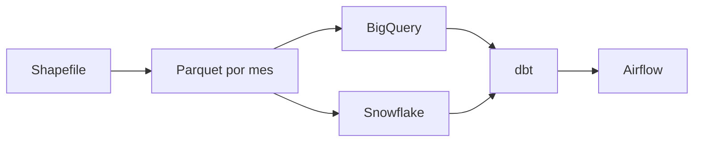

# Incidentes de tránsito de Medellín

Pipeline incremental de 370.404 incidentes (2014–2022): del shapefile a un modelo
listo para análisis.

## Arquitectura



El mismo proyecto dbt alimenta BigQuery y Snowflake. Airflow solo ordena los pasos.

| Fase | Qué es | Estado |
|---|---|---|
| F0 | Proyecto Python, ruff, pre-commit | Listo, en tu PC |
| F1 | Shapefile a Parquet, un mes por ejecución | Listo. 103 meses en landing. El replay publica uno por corrida |
| F2 | Carga a BigQuery | Después |
| F3 | Modelos dbt | Después |
| F4 | Airflow | Después |
| F5 | El mismo dbt, contra Snowflake | Después |

Los datos no van en Git. Van en `data/`, que está ignorada.

## Revisar el código

```powershell
uv sync
uv run ruff check .
```
